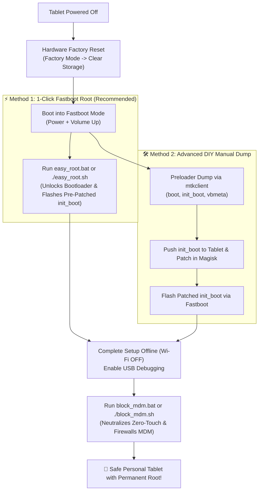

# 🔓 Acer One 8 (T4-82L Gen 2) Root, Zero-Touch / MDM Bypass & GSI Guide

[](https://github.com/codeturbulent/Acerone8_)
[-green?logo=android)](https://github.com/codeturbulent/Acerone8_)
[-orange)](https://github.com/codeturbulent/Acerone8_)
[](https://github.com/topjohnwu/Magisk)
[](https://www.youtube.com/watch?v=vdDfN86wU0I)
[](#-defeating-the-tectoro-pvt-ltd--google-zero-touch-lock)

> **The definitive, tested guide to factory resetting, unlocking bootloader, 1-click rooting with Magisk (GKI), bypassing institutional Zero-Touch/MDM locks ("Your device at work" / Tectoro), and flashing LineageOS GSI ROMs on the Acer One 8 (T4-82L Gen 2).**

---

## 📺 Video Walkthrough
[](https://www.youtube.com/watch?v=vdDfN86wU0I)

> 📹 **Watch the real-time recording and walkthrough on YouTube:**  
> 👉 [https://www.youtube.com/watch?v=vdDfN86wU0I](https://www.youtube.com/watch?v=vdDfN86wU0I)

---

## 📑 Table of Contents
0. [📺 Video Walkthrough](#-video-walkthrough)
1. [End-to-End Workflow Diagram](#-end-to-end-workflow-diagram)
2. [Device Architecture & Profile](#-device-architecture--profile)
3. [Step 0: One-Click Environment Setup (Windows & Linux)](#step-0-one-click-environment-setup-fresh-pc-windows--linux)
4. [⚡ Method 1: 1-Click Fastboot Root (Recommended - 2 Minutes)](#-method-1-1-click-fastboot-root-recommended---2-minutes)
5. [🛠️ Method 2: Advanced DIY Partition Dump & Manual Patching](#-method-2-advanced-diy-partition-dump--manual-patching)
6. [🛡️ Defeating "Your device at work" / Tectoro Zero-Touch Lock](#-defeating-the-tectoro-pvt-ltd--google-zero-touch-lock)
7. [⚡ Flashing LineageOS / Custom GSI ROMs](#-flashing-lineageos--custom-gsi-roms)
8. [🛟 Emergency Unbrick Failsafe](#-emergency-unbrick-failsafe)

---

## 🗺️ End-to-End Workflow Diagram



---

## 📱 Device Architecture & Profile

| Property | Value / Specification |
| :--- | :--- |
| **Model Name** | Acer One 8 (T4-82L-G2) |
| **Board / Platform** | `tb8786p1_64_k66` |
| **Processor (SoC)** | MediaTek MT6768 / MT6769 (Helio P65 / Helio G85 k68v1) |
| **Partitioning Scheme** | A/B Dynamic Partitions (Slot `b` active) |
| **Android Architecture** | Android 14+ / Generic Kernel Image (GKI Kernel v4) |
| **Ramdisk Location** | `init_boot` partition (NOT inside `boot`) |
| **Target Build Discovered** | `Acer_20261021` (Custom OEM / Educational distribution build) |
| **Distribution Context** | Widely distributed under student empowerment schemes (DgShakti / UP Government / Tectoro Pvt Ltd) |

---

## 🔍 Key Discoveries & Low-Level Fixes

### 1. Missing "Wipe Data / Factory Reset" in Recovery
Institutional builds remove the standard recovery wipe option to prevent MDM removal. Fastboot wipe (`fastboot -w`) is blocked in locked state.
- **The Solution:** MediaTek Factory Mode (`Power + Volume Down`) contains an engineering menu with **`Clear Storage`** (or `Clear eMMC`).

### 2. Pre-Bundled Working Magisk Image (`init_boot_patched.img`)
All student empowerment tablets running this release share the identical GKI boot header v4 partition. To save users from `mtkclient` driver issues, button timing, and the Android Magisk app file-picker *"Unable to extract"* bug, this repository comes with a verified, tested **`tablet_backup/init_boot_patched.img`** ready to flash directly!

### 3. MediaTek Helio G85 Preloader Bugs & Fixes (For DIY Dumpers)
When dumping partitions with `mtkclient`, modern Helio G85 preloaders trigger two crashes:
- **Watchdog Register Lock (`USBError 5`):** Use `--skipwdt` and wrap the watchdog write in `try...except` in `mtk_preloader.py`.
- **Missing 4-Byte MEID Crash (`struct.error: unpack requires a buffer of 4 bytes`):** Modern preloaders return 0 bytes for MEID. The script checks buffer length (`len(buf) == 4`) before unpacking.

---

## 🛠️ Step-by-Step Walkthrough

> [!CAUTION]
> ### ⚠️ CRITICAL RULE: DO NOT CONNECT TO WI-FI / INTERNET YET!
> On institutional tablets, the device's IMEI and serial number are registered with **Google Zero-Touch Enrollment**. Connecting to Wi-Fi before neutralizing MDM will immediately trigger Google Play Services to download the management profile and lock your tablet with a wipe countdown.
> 
> - **After Factory Reset:** Skip the internet setup ("Set up offline" / "Skip").
> - **After Bootloader Unlock:** Skip the internet setup again ("Set up offline" / "Skip").
> - **Keep Wi-Fi OFF** until you have completed **`block_mdm.bat` / `./block_mdm.sh`**.

---

### Step 0: One-Click Environment Setup (Fresh PC: Windows & Linux)
Whether you are on a fresh Windows machine or Linux, you do not need to install global ADB, Fastboot, or hunt down drivers manually. The setup scripts download and extract all dependencies directly into the local `tools/` directory.

#### 1. Clone or Download This Repository
- **Via Git:**
  ```bash
  git clone https://github.com/codeturbulent/Acerone8_.git
  cd Acerone8_
  ```
- **Direct ZIP Download (No Git needed):**  
  👉 **[📥 Download Repository ZIP (main.zip)](https://github.com/codeturbulent/Acerone8_/archive/refs/heads/main.zip)**  
  *(Extract the downloaded `.zip` file to your computer and open a terminal inside the extracted `Acerone8_` folder).*

#### 2. Run the Automated Setup

##### 🪟 Windows Setup:
Double-click **`setup_windows.bat`** (or run `setup_windows.bat` from Command Prompt/PowerShell).

> **What `setup_windows.bat` does automatically:**
> - Downloads Android SDK Platform-Tools (`adb.exe`, `fastboot.exe`) into `tools\platform-tools\`.
> - Pre-downloads the official **Magisk APK** directly into `tablet_backup\Magisk.apk`.
> - Silently installs Python 3.11 (if missing) and UsbDk (MediaTek low-level driver).
> - Stages Google USB Drivers and configures `mtkclient` for optional partition dumping.

##### 🐧 Linux Setup:
```bash
chmod +x setup_linux.sh && ./setup_linux.sh
```

---

## ⚡ Method 1: 1-Click Fastboot Root (Recommended - 2 Minutes)

> [!TIP]
> This is the fastest, easiest method for 99% of users. It uses the pre-tested, verified Magisk patched image included in `tablet_backup/init_boot_patched.img`.

### Step 1: Boot into Fastboot Mode
1. Power OFF your tablet completely.
2. Hold **Power + Volume Up** until the boot selection menu appears.
3. Use **Volume Up** to navigate to `[Fastboot Mode]` and press **Volume Down** to select it.
4. Plug in the USB cable to your PC.

### Step 2: Run 1-Click Root
- **Windows:** Double-click **`easy_root.bat`** (or run `.\easy_root.ps1` in PowerShell).
- **Linux:** Run `./easy_root.sh`.

> ⚠️ **LOOK AT TABLET SCREEN:** When prompted by the script, press **Volume Up** on the tablet to confirm the bootloader unlock!

The script will automatically:
1. Confirm Fastboot connection.
2. Unlock the bootloader (`fastboot flashing unlock`).
3. Flash the verified Magisk root image to both `init_boot_a` and `init_boot_b`.
4. Reboot the tablet into Android.

### Step 3: Complete Offline Setup & Enable USB Debugging
1. When Android boots up, choose **"Set up offline"** or **Skip**. **DO NOT connect to Wi-Fi.**
2. Open **Settings > About tablet** and tap **Build number** 7 times.
3. Open **Settings > System > Developer options** and enable **USB debugging**.

### Step 4: Run the Anti-MDM Script
Connect the tablet via USB and run:
- **Windows:** Double-click **`block_mdm.bat`**.
- **Linux:** Run `./block_mdm.sh`.

*The script will install the Magisk app, verify root (`uid=0`), disable Zero-Touch activities, firewall DeviceLockController at the kernel level, and install the permanent boot service.*

🎉 **Done! Your tablet is now permanently rooted and 100% safe to connect to Wi-Fi!**

---

## 🛠️ Method 2: Advanced DIY Partition Dump & Manual Patching
*(For developers, alternative firmware revisions, or anyone wanting to dump their own stock partition backups).*

### Step 1: Hardware Factory Reset (MediaTek Factory Mode)
1. Power the tablet completely **OFF**.
2. Press and hold **Power + Volume Down**.
3. Release both keys when the Factory Mode menu appears.
4. Use **Volume Down** to navigate to **Clear Storage** (or Clear eMMC).
5. Press **Power button** to confirm. Tablet formats and reboots.
6. When setup wizard appears, choose **"Set up offline"** / **Skip**. **DO NOT connect to Wi-Fi.**

### Step 2: Bootloader Unlock
1. Enable **Developer options** and toggle **OEM unlocking** + **USB debugging** to ON.
2. Reboot into bootloader:
   ```cmd
   tools\platform-tools\adb.exe reboot bootloader
   ```
3. Unlock bootloader:
   ```cmd
   tools\platform-tools\fastboot.exe flashing unlock
   ```
4. Press **Volume Up** on the tablet to confirm.
5. Reboot tablet:
   ```cmd
   tools\platform-tools\fastboot.exe reboot
   ```
6. Complete offline setup again and re-enable **USB debugging**.

### Step 3: Partition Dump via mtkclient
From the `Acerone8_` root folder, run:
- **Windows:** `dump_windows.bat`
- **Linux:** `./dump_linux.sh`

**Connection Procedure:**
1. Turn OFF your tablet.
2. When prompted `Waiting for PreLoader VCOM`, hold **BOTH Volume Up + Volume Down** (no Power button) and plug in USB.
3. Keep holding until `mtkclient` dumps `boot_a`, `boot_b`, `init_boot_a`, `init_boot_b`, `vbmeta_a`, and `vbmeta_b`.
4. Originals are preserved in `tablet_backup/STOCK_ORIGINALS/`.

### Step 4: Patching with Magisk
1. Push stock `init_boot_b.img` to the tablet:
   ```cmd
   tools\platform-tools\adb.exe push tablet_backup\init_boot_b.img /sdcard/Download/init_boot.img
   ```
2. Install Magisk APK:
   ```cmd
   tools\platform-tools\adb.exe install -r tablet_backup\Magisk.apk
   ```
3. Open Magisk app on tablet $\rightarrow$ **Install** $\rightarrow$ **Select and Patch a File**.
   > [!TIP]
   > **Fixing "Unable to extract" error:** If Magisk shows *"Unable to extract boot image"*, tap the hamburger menu in the file picker, select **Internal Storage** directly (not "Recent" or "Downloads" shortcut), then select `init_boot.img`.
4. Pull the patched image back to PC:
   ```powershell
   $PATCHED_FILE = (.\tools\platform-tools\adb.exe shell "ls /sdcard/Download/magisk_patched-*.img").Trim()
   .\tools\platform-tools\adb.exe pull "$PATCHED_FILE" tablet_backup\magisk_patched.img
   ```
5. Flash via Fastboot:
   ```cmd
   tools\platform-tools\adb.exe reboot bootloader
   tools\platform-tools\fastboot.exe flash init_boot_b tablet_backup\magisk_patched.img
   tools\platform-tools\fastboot.exe reboot
   ```

---

## 🛡️ Defeating the "Tectoro Pvt Ltd" / Google Zero-Touch Lock

### What happens when connecting to Wi-Fi:
The tablet's IMEI is registered to an enterprise portal (**Tectoro Pvt Ltd**). When Google Play Services (GMS) connects to the internet, it receives a Zero-Touch payload commanding it to install Android Device Policy and force a wipe countdown (*"Your device will automatically reset in 1 hour 55 minutes"*).

### How to permanently destroy this lock:

#### Option 1: Run the Automated Script (Recommended)
With your tablet rooted, powered on, and connected via USB with USB debugging enabled:
- **Windows:** Double-click **`block_mdm.bat`**.
- **Linux:** Run `./block_mdm.sh`.

#### Option 2: Run Directly in Terminal via ADB
```bash
tools/platform-tools/adb shell
su

# 1. Disable MDM & Zero-Touch packages
pm disable com.google.android.gms/.enterprise.zerotouch.ui.FactoryResetActivity
pm disable com.google.android.gms/.enterprise.zerotouch.businesslogic.ZeroTouchGmsTaskService
pm disable com.android.managedprovisioning
pm disable com.chipc.update

# 2. Lock Zero-Touch preferences file
if [ -f /data/data/com.google.android.gms/shared_prefs/zero_touch_prefs.xml ]; then
    chattr -i /data/data/com.google.android.gms/shared_prefs/zero_touch_prefs.xml 2>/dev/null
    echo -n "" > /data/data/com.google.android.gms/shared_prefs/zero_touch_prefs.xml
    chmod 444 /data/data/com.google.android.gms/shared_prefs/zero_touch_prefs.xml
    chattr +i /data/data/com.google.android.gms/shared_prefs/zero_touch_prefs.xml 2>/dev/null
fi

# 3. Kernel Firewall: Block DeviceLockController
DLC_UID=$(pm list packages -U | grep com.android.devicelockcontroller | sed -n "s/.*uid://p")
if [ -n "$DLC_UID" ]; then
    iptables -I OUTPUT -m owner --uid-owner "$DLC_UID" -j DROP
    ip6tables -I OUTPUT -m owner --uid-owner "$DLC_UID" -j DROP
fi
```

---

## ⚡ Flashing LineageOS / Custom GSI ROMs

Because the tablet supports **Project Treble** and **Dynamic Partitions**, you can flash pure LineageOS GSIs:

1. Download an **ARM64 A/B GSI** (e.g. [AndyCGYan's LineageOS GSI](https://github.com/AndyCGYan/lineage_build_unified/releases) - look for `arm64_bgN` with GApps or `arm64_bvN` vanilla).
2. Extract the file to get `system.img` in your `Acerone8_` folder.
3. Reboot to **Fastbootd** (Userspace Fastboot) and flash:

- **Windows:**
  ```cmd
  tools\platform-tools\adb.exe reboot fastboot
  tools\platform-tools\fastboot.exe flash system system.img
  tools\platform-tools\fastboot.exe -w
  tools\platform-tools\fastboot.exe reboot
  ```

- **Linux:**
  ```bash
  tools/platform-tools/adb reboot fastboot
  tools/platform-tools/fastboot flash system system.img
  tools/platform-tools/fastboot -w
  tools/platform-tools/fastboot reboot
  ```

---

## 🛟 Emergency Unbrick Failsafe

If the device ever bootloops, restore the original untouched stock images in seconds from the `Acerone8_` root folder:

- **Windows:**
  ```cmd
  tools\platform-tools\fastboot.exe flash init_boot_b tablet_backup\STOCK_ORIGINALS\init_boot_b.img
  tools\platform-tools\fastboot.exe flash boot_b tablet_backup\STOCK_ORIGINALS\boot_b.img
  tools\platform-tools\fastboot.exe reboot
  ```

- **Linux:**
  ```bash
  tools/platform-tools/fastboot flash init_boot_b tablet_backup/STOCK_ORIGINALS/init_boot_b.img
  tools/platform-tools/fastboot flash boot_b tablet_backup/STOCK_ORIGINALS/boot_b.img
  tools/platform-tools/fastboot reboot
  ```

---

## 🌟 Sharing & Contributing
If this guide helped you recover or free your tablet, please give it a **⭐ Star** on GitHub and share the link in student and Android forums!

- **Repository:** [https://github.com/codeturbulent/Acerone8_](https://github.com/codeturbulent/Acerone8_)
- **Keywords:** Acer One 8, T4-82L, DgShakti Tablet, Tectoro Pvt Ltd, Swami Vivekananda Yuva Sashaktikaran Yojana, UP Free Tablet Yojana, MT6768, Helio G85, Zero-Touch Bypass, Magisk Root GKI.
