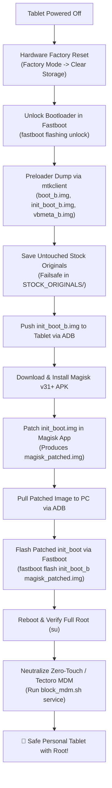

# 🔓 Acer One 8 (T4-82L Gen 2) Root, Zero-Touch / MDM Bypass & GSI Guide

[](https://github.com/codeturbulent/Acerone8_)
[-green?logo=android)](https://github.com/codeturbulent/Acerone8_)
[-orange)](https://github.com/codeturbulent/Acerone8_)
[](https://github.com/topjohnwu/Magisk)
[](#-defeating-the-tectoro-pvt-ltd--google-zero-touch-lock)

> **The definitive, tested guide to factory resetting, low-level partition dumping, fixing MTK Preloader bugs, unlocking bootloader, rooting with Magisk (GKI), bypassing institutional Zero-Touch/MDM locks ("Your device at work" / Tectoro), and flashing LineageOS GSI ROMs on the Acer One 8 (T4-82L Gen 2).**

---

## 📑 Table of Contents
0. [Step 0: Clone This Repository](#step-0-clone-this-repository)
1. [End-to-End Workflow Diagram](#-end-to-end-workflow-diagram)
2. [Device Architecture & Profile](#-device-architecture--profile)
3. [Key Discoveries & Low-Level Fixes](#-key-discoveries--low-level-fixes)
4. [Step 1: Hardware Factory Reset (MediaTek Factory Mode)](#step-1-hardware-factory-reset-mediatek-factory-mode)
5. [Step 2: Bootloader Unlock](#step-2-bootloader-unlock)
6. [Step 3: Zero-Risk Partition Dump via mtkclient](#step-3-zero-risk-partition-dump-via-mtkclient)
7. [Step 4: Downloading & Patching with Magisk v31+](#step-4-downloading--patching-with-magisk-v31)
8. [Step 5: Flashing via Fastboot](#step-5-flashing-via-fastboot)
9. [Step 6: Defeating "Your device at work" / Tectoro Zero-Touch Lock](#-defeating-the-tectoro-pvt-ltd--google-zero-touch-lock)
10. [Step 7: Flashing LineageOS / Custom GSI ROMs](#-flashing-lineageos--custom-gsi-roms)
11. [Emergency Unbrick Failsafe](#-emergency-unbrick-failsafe)

---

## 🗺️ End-to-End Workflow Diagram



---

## 📱 Device Architecture & Profile

| Property | Value / Specification |
| :--- | :--- |
| **Model Name** | Acer One 8 (T4-82L-G2) |
| **Board / Platform** | `tb8786p1_64_k66` |
| **Processor (SoC)** | MediaTek MT6768 / MT6769 (Helio P65 / Helio G85 k68v1) |
| **Partitioning Scheme** | A/B Dynamic Partitions (Slot `b` active) |
| **Android Architecture** | Android 14+ / Generic Kernel Image (GKI Kernel v4) |
| **Ramdisk Location** | `init_boot` partition (NOT inside `boot`) |
| **Target Build Discovered** | `Acer_20261021` (Custom OEM / Educational distribution build) |
| **Distribution Context** | Widely distributed under student empowerment schemes (DgShakti / UP Government / Tectoro Pvt Ltd) |

---

## 🔍 Key Discoveries & Low-Level Fixes

### 1. Missing "Wipe Data / Factory Reset" in Recovery
Institutional builds remove the standard recovery wipe option to prevent MDM removal. Fastboot wipe (`fastboot -w`) is blocked in locked state.
- **The Solution:** MediaTek Factory Mode (`Power + Volume Down`) contains an engineering menu with **`Clear Storage`** (or `Clear eMMC`).

### 2. The Custom Build Danger (`Acer_20261021`)
Flashing random stock ROMs from the internet causes bootloops, broken Wi-Fi, or unresponsive touchscreens due to kernel/touch module mismatches.
- **The Solution:** Always dump the tablet's **exact live partitions** directly over USB before flashing anything.

### 3. MediaTek Helio G85 Preloader Bugs & Fixes
When dumping partitions with `mtkclient`, modern Helio G85 preloaders trigger two crashes:
- **Watchdog Register Lock (`USBError 5`):** Use `--skipwdt` and wrap the watchdog write in `try...except` in `mtk_preloader.py`.
- **Missing 4-Byte MEID Crash (`struct.error: unpack requires a buffer of 4 bytes`):** Modern preloaders return 0 bytes for MEID. The script must check buffer length (`len(buf) == 4`) before unpacking.

---

## 🛠️ Step-by-Step Walkthrough

> [!CAUTION]
> ### ⚠️ CRITICAL RULE: DO NOT CONNECT TO WI-FI / INTERNET YET!
> On institutional tablets, the device's IMEI and serial number are registered with **Google Zero-Touch Enrollment**. Connecting to Wi-Fi before rooting will immediately trigger Google Play Services to download the management profile and lock your tablet with a wipe countdown.
> 
> - **After 1st Reset (Factory Mode):** Skip the internet setup ("Set up offline").
> - **After 2nd Reset (Bootloader Unlock):** Skip the internet setup again ("Set up offline").
> - **Keep Wi-Fi OFF** until you have completed **Step 6 (`block_mdm.sh`)**.

### Step 0: Clone This Repository
First, clone this repository onto your computer so you have all the configuration files and helper scripts:

```bash
git clone https://github.com/codeturbulent/Acerone8_.git
cd Acerone8_
```

---

### Step 1: Hardware Factory Reset (MediaTek Factory Mode)
1. Power the tablet completely **OFF**.
2. Press and hold **Power + Volume Down**.
3. Release both keys when the Chinese/English test menu appears.
4. Use **Volume Down** to navigate to **Clear Storage**.
5. Press the **Power button** (or Volume Up) to confirm. The tablet formats and reboots fresh.
6. **Setup Wizard (1st Reset):** When the Android setup wizard appears, select **"Set up offline"** (or **Skip**). **DO NOT connect to Wi-Fi.**

---

### Step 2: Bootloader Unlock
1. In the offline Android interface, open **Settings > About tablet** and tap **Build number** 7 times.
2. In **Settings > System > Developer options**:
   - Toggle **OEM unlocking** -> ON.
   - Toggle **USB debugging** -> ON.
3. Connect to PC and reboot to Fastboot:
   ```bash
   adb reboot bootloader
   ```
4. Unlock bootloader:
   ```bash
   fastboot flashing unlock
   ```
5. Press **Volume Up** on the tablet to confirm. Check unlock status:
   ```bash
   fastboot getvar unlocked
   # Result: unlocked: yes
   ```
6. Reboot the tablet:
   ```bash
   fastboot reboot
   ```
7. **Setup Wizard (2nd Reset):** Unlocking the bootloader automatically factory resets the tablet a second time. When the setup wizard appears, again choose **"Set up offline"** / **Skip**. **DO NOT connect to Wi-Fi.**
8. Re-enable **USB debugging** in Developer options so ADB can communicate with the tablet.

---

### Step 3: Zero-Risk Partition Dump via mtkclient
*Do not skip this step! Dumping your tablet's exact live partitions is your 100% guarantee against bricking.*

#### 1. Create the Backup Directories
From your repository root (`Acerone8_/`), create the storage directory:
```bash
mkdir -p tablet_backup/STOCK_ORIGINALS
```

#### 2. Clone `mtkclient` & Set Up Environment
```bash
git clone https://github.com/bkerler/mtkclient
cd mtkclient
python3 -m venv .venv
source .venv/bin/activate
pip install pycryptodomex pyusb pyserial colorama
```

> [!NOTE]
> **Helio G85 Fix:** If `mtk.py` throws `struct.error: unpack requires a buffer of 4 bytes` when reading MEID, open `mtkclient/Library/mtk_preloader.py` and ensure `buf = self.usbread(4)` checks `if len(buf) == 4:` before calling `unpack(">I", buf)`.

#### 3. Run the Partition Dump Command
Execute the dump using the virtual environment's Python binary with `sudo` (so it accesses the installed dependencies and raw USB devices):
```bash
sudo .venv/bin/python3 mtk.py r boot_b,init_boot_b,vbmeta_b \
    ../tablet_backup/boot_b.img,../tablet_backup/init_boot_b.img,../tablet_backup/vbmeta_b.img \
    --skipwdt
```

4. **Connect the Tablet:**
   - Power off the tablet completely.
   - When the terminal displays `Waiting for PreLoader VCOM...`, plug the USB cable in **without holding any buttons** (or hold **Volume Up** only).
   - Keep it connected until all 3 partitions report `100.0% Read` and `All partitions were dumped`.

#### 4. Save Immutable Copies of the Stock Originals
Once the dump finishes, copy the untouched images into your backup archive and return to the main folder:
```bash
cp ../tablet_backup/*.img ../tablet_backup/STOCK_ORIGINALS/
cd ..
```
*You now have `boot_b.img`, `init_boot_b.img`, and `vbmeta_b.img` safely stored in `tablet_backup/`!*

---

### Step 4: Downloading & Patching with Magisk v31+
*Because this device uses modern Android GKI (Generic Kernel Image) architecture, you must patch `init_boot`, NOT `boot`.*

#### 1. Push the Stock `init_boot_b.img` to Tablet
Make sure your tablet is powered ON, USB Debugging is enabled, and it is connected via USB:
```bash
adb push tablet_backup/init_boot_b.img /sdcard/Download/init_boot.img
```

#### 2. Download & Install Magisk v31+ Directly
Download the latest official Magisk APK using `curl` and install it onto your tablet:
```bash
curl -L -o tablet_backup/Magisk.apk "https://github.com/topjohnwu/Magisk/releases/download/v31.1/Magisk-v31.1.apk"
adb install -r tablet_backup/Magisk.apk
```

#### 3. Patch `init_boot.img` Inside the Magisk App
1. Open the newly installed **Magisk** app on your tablet screen.
2. In the top card (next to **Magisk**), tap **Install**.
3. Under **Method**, select **"Select and Patch a File"**.
4. A file picker will open:
   - Navigate to your **Downloads** folder.
   - Tap on **`init_boot.img`**.
5. Tap **LET'S GO!** in the top right corner.
6. Magisk will unpack, hook, and repack the ramdisk. In a few seconds, it will print:
   ```
   Output file is written to /storage/emulated/0/Download/magisk_patched-xxxx_xxxxx.img
   - All done!
   ```

#### 4. Pull the Patched Image to Your PC
Pull the newly created patched file back to your computer:
```bash
adb pull /sdcard/Download/magisk_patched-*.img tablet_backup/magisk_patched.img
```
*You now have `magisk_patched.img` ready for flashing!*

---

### Step 5: Flashing Patched Image via Fastboot
1. Reboot the tablet into bootloader (Fastboot mode):
   ```bash
   adb reboot bootloader
   ```
2. Flash the patched image into the active `init_boot` slot (`init_boot_b`):
   ```bash
   fastboot flash init_boot_b tablet_backup/magisk_patched.img
   ```
3. Reboot the tablet into Android:
   ```bash
   fastboot reboot
   ```
4. **Finalize Magisk Setup:**
   - Once Android boots, open the **Magisk** app.
   - If Magisk asks: *"Requires Additional Setup. Do you want to proceed?"*, tap **OK** (it will perform a quick 5-second reboot to finalize its environment).
5. **Verify Full Root Access:**
   Open a terminal on your computer and test `su`:
   ```bash
   adb shell "su -c id"
   # Output:
   # uid=0(root) gid=0(root) groups=0(root) context=u:r:magisk:s0
   ```
   *(Grant the superuser prompt on the tablet screen if prompted).*

   - **Magisk Version:** `31.1:MAGISK:R`
   - **Root Context:** Unrestricted Magisk SELinux domain (`u:r:magisk:s0`).
   **Congratulations! Your tablet is now 100% rooted!**

---

## 🛡️ Defeating the "Tectoro Pvt Ltd" / Google Zero-Touch Lock

### What happens when connecting to Wi-Fi:
The tablet's IMEI is registered to an enterprise portal (**Tectoro Pvt Ltd**). When Google Play Services (GMS) connects to the internet, it receives a Zero-Touch payload commanding it to install Android Device Policy and force a wipe countdown (*"Your device will automatically reset in 1 hour 55 minutes"*).

### How to permanently destroy this lock:

Run our automated script:
```bash
./scripts/block_mdm.sh
```

Or execute directly via ADB root:

1. **Disable Zero-Touch Factory Reset & Network Tasks in Google Play Services:**
   ```bash
   adb shell "su -c 'pm disable com.google.android.gms/.enterprise.zerotouch.ui.FactoryResetActivity'"
   adb shell "su -c 'pm disable com.google.android.gms/.enterprise.zerotouch.businesslogic.ZeroTouchGmsTaskService'"
   ```

2. **Make the Zero-Touch Configuration File Immutable:**
   ```bash
   adb shell "su -c 'echo -n \"\" > /data/data/com.google.android.gms/shared_prefs/zero_touch_prefs.xml'"
   adb shell "su -c 'chmod 444 /data/data/com.google.android.gms/shared_prefs/zero_touch_prefs.xml'"
   adb shell "su -c 'chattr +i /data/data/com.google.android.gms/shared_prefs/zero_touch_prefs.xml'"
   ```
   *The `+i` (immutable) attribute prevents even Google Play Services or system services from ever writing a reset command or token again.*

3. **Disable Android Enterprise Managed Provisioning & Vendor OTA:**
   ```bash
   adb shell "su -c 'pm disable com.android.managedprovisioning; pm disable-user --user 0 com.android.managedprovisioning'"
   adb shell "su -c 'pm disable com.chipc.update; pm disable-user --user 0 com.chipc.update'"
   ```

4. **Firewall DeviceLockController at Kernel Level:**
   ```bash
   DLC_UID=$(adb shell "pm list packages -U | grep com.android.devicelockcontroller | sed -n 's/.*uid://p'")
   adb shell "su -c 'iptables -I OUTPUT -m owner --uid-owner $DLC_UID -j DROP; ip6tables -I OUTPUT -m owner --uid-owner $DLC_UID -j DROP'"
   ```

5. **Install Persistent Magisk Boot Service:**
   The script in `scripts/block_mdm.sh` automatically installs `/data/adb/service.d/block_mdm.sh` so these protections run on every boot!

---

## ⚡ Flashing LineageOS / Custom GSI ROMs

Because the tablet supports **Project Treble** and **Dynamic Partitions**, you can flash pure LineageOS GSIs without compiling from source:

1. Download an **ARM64 A/B GSI** (e.g. [AndyCGYan's LineageOS GSI](https://github.com/AndyCGYan/lineage_build_unified/releases) - look for `arm64_bgN` with GApps or `arm64_bvN` vanilla).
2. Extract the file to get `system.img`.
3. Reboot to **Fastbootd** (Userspace Fastboot):
   ```bash
   adb reboot fastboot
   ```
4. Flash system image and format:
   ```bash
   fastboot flash system system.img
   fastboot -w
   fastboot reboot
   ```

---

## 🛟 Emergency Unbrick Failsafe

If the device ever bootloops, restore the original untouched stock images in seconds:

```bash
fastboot flash init_boot_b tablet_backup/STOCK_ORIGINALS/init_boot_b.img
fastboot flash boot_b tablet_backup/STOCK_ORIGINALS/boot_b.img
fastboot reboot
```

---

## 🌟 Sharing & Contributing
If this guide helped you recover or free your tablet, please give it a **⭐ Star** on GitHub and share the link in student and Android forums!

- **Repository:** [https://github.com/codeturbulent/Acerone8_](https://github.com/codeturbulent/Acerone8_)
- **Keywords:** Acer One 8, T4-82L, DgShakti Tablet, Tectoro Pvt Ltd, Swami Vivekananda Yuva Sashaktikaran Yojana, UP Free Tablet Yojana, MT6768, Helio G85, Zero-Touch Bypass, Magisk Root GKI.
